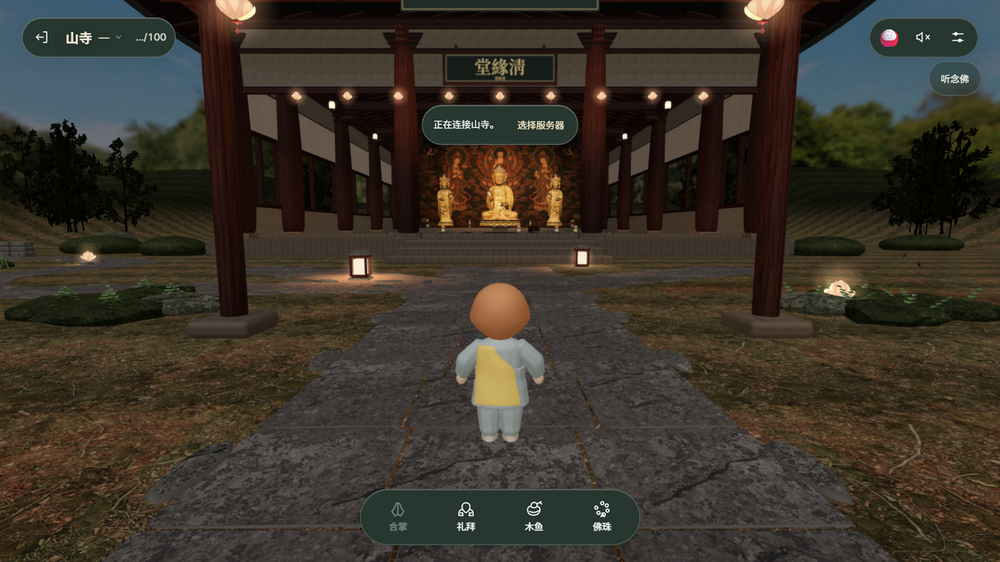

<div align="center">

# 山寺 · Sansa

**sansatemple.com 的完整本地镜像 —— 汉化 · 单机多人模拟 · 一键本地运行**

[](#-本地运行) [](#-本地运行) [](#)

*一起无言静坐的线上寺院。转佛珠、行礼拜、小憩片刻。*



*清緣堂大殿:金色佛像三尊、满堂蒲团,虚拟访客正在佛前打坐。*

</div>

---

## ✨ 这是什么

[sansatemple.com](https://sansatemple.com)(산사)是一个韩国开发者制作的在线禅修体验站。本项目将原站**完整镜像**下来,并做了三层改造,使其成为一个**无任何外部依赖的单机可玩项目**:

| 改造 | 说明 |
|---|---|
| 🇨🇳 **完整汉化** | 约 260 条界面文本汉化为简体中文,包括无障碍标签、页面元数据、PWA manifest;三轮残留扫描清零 |
| 🏯 **单机多人模拟** | 逆向原站 `V2` 实时在线协议(WebSocket 快照/增量/座位/香供/事件),`server.mjs` 完整还原;随机数量的虚拟玩家在场景中**参拜、落座、上香、漫步** |
| 📄 **Pages 单机模式** | 部署到静态托管(如 GitHub Pages)时,虚拟玩家模拟自动切换到**浏览器页面内**运行,无需任何后端 |

## 🎮 能做什么

- **漫游** 清緣堂大殿、灯笼步道、莲池庭院(点击地面 / WASD / 拖动环视 / 滚轮缩放)
- **礼拜** 站立或蒲团上连续叩拜 · **合掌** 向同在之人致意 · **敲木鱼** 手动或自动
- **拨佛珠** 108 颗一圈,计数持久保存 · **上香** 于香炉前,青烟袅袅两分钟
- **听念佛** 晨课 05:00 / 晚课 18:00(韩国时间)个人聆听或共修
- **昼与夜** 场景随时间变换光影与音景

## 🚀 本地运行

```bash
node server.mjs          # 仓库根目录,零依赖,Node 18+
# 打开 http://127.0.0.1:4173/
```

> **必须用 `node server.mjs`** 而不是纯静态服务器:本地服务器在静态资源之外还实现了原站的实时在线协议 —— `GET /api/rooms`(服务器目录)与 `WS /presence`(在线同步),虚拟玩家模拟也运行在服务器内存里。多开几个标签页,它们会互相看见。

## 🌐 在线访问(GitHub Pages)

仓库对应 Pages:**https://studyguy.github.io/**

静态托管没有本地服务器那份在线层,部署版会自动进入**单机模式**(页面内检测:非 localhost 主机名时,由 index.html 内建的模拟器接管在线层)——体验完整,但各访客互不可见。

<details>
<summary><b>⚠️ 当前 Pages 状态与补完方法(点击展开)</b></summary>

目前 Pages 上根文件可访问,但 `assets/`、`fonts/` 等子目录 404 —— 这是 GitHub Pages 传统(legacy/Jekyll)构建器对本仓库的子目录复制缺陷,非仓库内容问题(仓库 tree 已验证完整)。

**补完方法(推荐,约 2 分钟):**

```bash
# 1. 给 token 补 workflow 权限(浏览器设备授权)
gh auth refresh -h github.com -s workflow

# 2. 恢复仓库内的部署工作流并推送
mkdir -p .github/workflows
# 创建 .github/workflows/deploy.yml,内容见下
git add .github tools/screenshots && git commit -m "ci: actions 部署" && git push

# 3. 把 Pages 源切换为 GitHub Actions
gh api -X POST repos/studyguy/studyguy.github.io/pages -f build_type=workflow
```

`deploy.yml` 内容:

```yaml
on: { push: { branches: [main] }, workflow_dispatch: }
permissions: { contents: read, pages: write, id-token: write }
jobs:
  deploy:
    runs-on: ubuntu-latest
    environment: { name: github-pages }
    steps:
      - uses: actions/checkout@v4
      - uses: actions/upload-pages-artifact@v3
        with: { path: . }
      - uses: actions/deploy-pages@v4
```

Actions 的 `upload-pages-artifact` 是纯 zip 打包,绕开 legacy 构建器的所有怪癖。
(本仓库 push 时因 token 缺少 `workflow` scope 被拒,故工作流文件未入库,按上文手动创建即可。)

</details>

## 🧭 架构

```
┌────────────────────────── 浏览器(原站 bundle,已汉化) ──────────────────────────┐
│  三.js 场景渲染  ·  UI/弹窗  ·  rAF 看门狗  ·  WS 客户端(V2)  ·  页面内模拟器  │
└───────────┬─────────────────────────────────────────────┬──────────────────────┘
            │ ws://127.0.0.1/presence + /api/rooms         │ 非 localhost 时
┌───────────▼───────────────────┐          ┌───────────────▼──────────────────────┐
│  server.mjs(本地唯一服务器)    │          │  页面内单机模拟(无后端环境)            │
│  · 静态资源                    │          │  · 同一套行为状态机,在浏览器内运行     │
│  · 房间目录(唯一服务器 maru)   │          │  · 虚拟玩家参拜/落座/上香/漫步          │
│  · WS presence 协议(快照/增量) │          │  · 无外部依赖,GitHub Pages 可用        │
│  · 虚拟玩家行为状态机           │          └──────────────────────────────────────┘
└───────────────────────────────┘
```

**虚拟玩家行为系统**(随机 3~12 位,中文诗意名字:行云、扫叶、听雨……):

```
入场 → 挑选活动 ─┬─ 30% 参拜:走到佛像前 → 面向佛连拜 1~3 次 → 静立
                 ├─ 25% 落座:预订空蒲团 → 走过去 → 盘坐 20~90 秒(偶尔拨珠) → 起身
                 ├─ 13% 上香:走到香炉旁 → 上香(青烟两分钟) → 静立
                 ├─ 18% 漫步:庭院步道连走 2~4 段
                 └─ 14% 伫立:原地张望,偶尔合掌
       随时间来去 · 蒲团 8 秒释放冷却(防抢座重叠) · 走路缓动插值 + 朝向
```

## 📁 目录结构

```
├─ index.html            入口(内联 shim:rAF 看门狗 / WS.close 兜底 / 单机模拟器)
├─ assets/               原站 bundle(汉化)、GLB 模型、PBR 贴图、图片
├─ fonts/ audio/ og/ v/  字体、音频、社交图、内容寻址副本
├─ server.mjs            本地服务器(静态 + 房间目录 + WS presence + 虚拟玩家)
├─ tools/                抓取、汉化、本地化补丁脚本与诊断工具
│   ├─ download-assets.mjs   全量资源下载 + sha256 校验
│   ├─ patch-local.mjs       bundle 幂等补丁(单服务器/本地端点/快速重连/单机分支)
│   ├─ zh-map.mjs            260 条中韩翻译映射
│   ├─ apply-zh.mjs          汉化应用器(最长键优先 + 残留扫描)
│   └─ api-push.mjs          经 Git Data API 推送(绕开被阻断的 git 通道)
└─ tools/screenshots/    验证截图
```

## 🛠 技术要点与排障实录

原站的在线层细节、以及汉化/本地化/部署过程中踩过的坑,详见 [README 之排障实录](#)。速览:

- **workers.dev 被墙绕过**:原站资源 CDN(Cloudflare Workers)被 DNS 污染 + SNI 阻断,后发现原站自身(Cloudflare Pages)同源托管了全部资源,直接下载并以 bundle 内置的 sha256 清单逐一校验
- **蒲团双订竞态**:两人同订一个蒲团 → 快照校验失败 → 重同步循环;修复为预订制 + 释放冷却
- **`close(1011)` 雷**:浏览器禁止 JS 使用保留 close code,原站异常恢复路径调用即抛错导致重连瘫痪;透明降级为 1000
- **rAF 冻结**:部分环境渲染循环停滞,rAF 看门狗自动切换定时器驱动
- **git 通道阻断**:github.com:443 按区域 IP 间歇阻断,本地 CONNECT 转发器借道可达边缘 IP;小提交走 Git Data API(`tools/api-push.mjs`)

## 📄 版权与致谢

- 原站与全部美术、音频素材版权归 **sansatemple.com 作者**所有;佛像素材源自 [国立中央博物馆](https://www.museum.go.kr)(공공누리 제1유형),木鱼/念佛音源源自 [공유마당](https://gongu.copyright.or.kr)(CC BY 4.0,作者 김용배)
- 本项目仅供**个人本地学习研究**,请勿部署到公网商用(本仓库 Pages 部署仅为技术演示,若权利人提出异议将立即下架)
- 原站架构精巧,本次逆向还原之乐尽在其中 🙏

<div align="center">

*법당을 여는 중 …… 法堂开放中*

</div>
